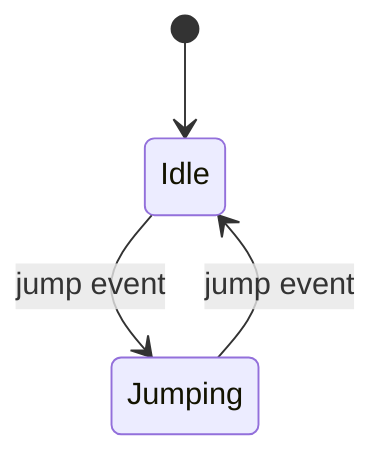

# GameLovers Statechart

Hierarchical statecharts for Unity 6 with nested and parallel regions, event transitions, choices, async waits, a live debugger, and a playable sample.

[](https://unity.com/download)
[](LICENSE.md)

## When to use it

Use Statechart when a flat FSM cannot express hierarchical behavior, concurrent regions, or controlled async waits clearly. The package is pipeline-neutral and requires UniTask for its `UniTask` wait overloads.

## Unity compatibility

| Item | Current policy |
| --- | --- |
| Minimum Unity version | `6000.0` |
| Supported streams | `6000.0.x`, `6000.3.x`, `6000.6.x` (LTS) |
| Statechart Debugger | All supported streams |
| Render pipeline | Pipeline-neutral |

## Install

Add UniTask explicitly when installing from Git. Use UniTask 2.5.11 or newer: 2.5.10's Editor code does not compile on Unity 6000.6.

```json
{
  "dependencies": {
    "com.cysharp.unitask": "https://github.com/Cysharp/UniTask.git?path=src/UniTask/Assets/Plugins/UniTask#2.5.11",
    "com.gamelovers.statechart": "https://github.com/CoderGamester/Statechart-HFSM.git#1.0.0"
  }
}
```

## First success

Keep events as fields: statechart event identity is by object instance, not by its display name. Give the chart a name so logs and the debugger can tell charts apart, and dispose it with its owner.

```csharp
using GameLovers.StatechartMachine;
using UnityEngine;

public sealed class PlayerStatechart : MonoBehaviour
{
    private readonly StatechartEvent _jump = new("Jump");
    private IStatechart _chart;

    private void Awake()
    {
        _chart = new Statechart("Player", factory =>
        {
            var initial = factory.Initial("Initial");
            var idle = factory.State("Idle");
            var jumping = factory.State("Jumping");

            initial.Transition().Target(idle);
            idle.Event(_jump).Target(jumping);
            jumping.Event(_jump).Target(idle);
        });
        _chart.Run();
    }

    private void OnDestroy() => _chart.Dispose();

    public void Jump() => _chart.Trigger(_jump);
}
```



## State kinds

| Factory method | Kind | Behavior |
| --- | --- | --- |
| `Initial` | Initial | Entry point of a region; exactly one per region |
| `Final` | Final | Completes its region |
| `State` | Simple | Waits for events; event transitions may omit a target to run an action only |
| `Transition` | Transition | Passes straight through to its target, running its callbacks |
| `Choice` | Choice | Takes the first transition whose condition is true, otherwise the one without a condition |
| `Wait` | Wait | Resumes when its `IWaitActivity` completes; still reacts to configured events |
| `TaskWait` | TaskWait | Awaits a `Task` or `UniTask`; ignores events while waiting |
| `Nest` | Nest | One nested region; completes when that region reaches its final state |
| `Split` | Split | Two or more parallel regions; completes when all of them finish |
| `Leave` | Leave | Leaves the enclosing nest or split from inside a region |

## Runtime semantics

| Topic | Behavior |
| --- | --- |
| `Trigger` | Ignored until `Run()` and while paused |
| Run to completion | An event triggered while another one is processed (for example from `OnEnter`) is queued and processed right after it |
| `Pause()` | Stops the chart, also mid-chain when called from a callback; `Run()` resumes from the same states |
| `Reset()` | Returns to the initial state without exit callbacks; drops queued events and abandons pending waits and tasks |
| `Dispose()` | Stops the chart for good, cancels token-aware tasks and removes it from the debugger; `Run()` then throws `ObjectDisposedException` |
| `TaskWait` faults | A task that throws is logged and still completes the state, so the chart and parent splits never wait forever |
| `TaskWait` threads | The chart always resumes on the main thread, even if the awaited task completes on a worker thread |
| Cancellation | `WaitingFor(Func<CancellationToken, UniTask>)` and the `Task` variant receive a token cancelled by `Reset()` and `Dispose()` |
| Callback exceptions | Enter, exit and transition exceptions are logged with the stack trace of the code that declared the failing state, and the chart keeps going |

The constructor rejects a setup without an initial state in every build. Other setup validation (missing targets, self loops, malformed choices, leave depth) runs only in the Editor and in `DEBUG` builds.

## Observe a running chart

Every chart exposes its structure and its live state, so tools, tests and logs read the same data:

```csharp
// Read-only view of the chart; it is the live chart itself, so it never goes stale.
foreach (var state in chart.RootRegion.States)
{
    Debug.Log($"{state.Path} ({state.Kind}) with {state.Transitions.Count} transitions");
}

// Active states, parents before children.
var active = new List<IStateNode>();
chart.GetActiveStates(active);

// Is one state active right now? Allocation-free.
var isIdle = chart.IsActive(active[0]);

// Every step in execution order: events, exits, transitions, enters, faults, lifecycle.
chart.Traced += trace => Debug.Log(trace);
```

Set `chart.LogsEnabled = true` (or `LogsEnabled` on a single state) to write the same trace lines to the console, for example `[Statechart 'Player'] Idle -> Jumping on 'Jump'`. Nothing is formatted or published while no one subscribes and logs are off.

## Statechart Debugger

Open **Tools > GameLovers > Statechart Debugger** in Play mode. Pick a chart from the toolbar; Run, Pause and Reset act on that chart. Two views read the same data; the **Live chart** and **Tree + trace** toolbar toggles turn each one on or off:

| View | What it shows |
| --- | --- |
| **Live chart** | Nested boxes: nest and split states contain their regions, split regions are dashed lanes, active states are green and newly entered ones flash |
| **Tree + trace** | An indented tree with the active states marked, and the latest 256 trace steps |

The **Copy** menu puts the Mermaid diagram, the active state paths or the trace history on the clipboard.

## Samples

Import **Game Flow** from the Package Manager's Samples tab. One statechart runs a small game loop that uses every state kind: a nested boot sequence with cancellable task waits, a menu, a split gameplay state (a player region and a waves region), a choice, leave states and results. It has on-screen buttons and an activity log, and is meant to be watched with the Statechart Debugger open. See the sample's `README.md`.

## Support

See [CHANGELOG.md](CHANGELOG.md) and file an [issue](https://github.com/CoderGamester/Statechart-HFSM/issues). `AGENTS.md` is contributor guidance, not end-user API documentation.
